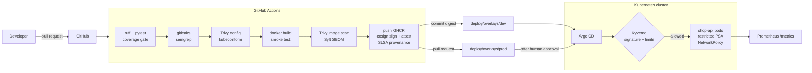

# Architecture

## The flow of one change
1. A pull request runs lint, unit tests (coverage ≥ 90 %), secret scan, SAST and IaC checks, builds the image,
   smoke-tests it, scans it and makes an SBOM. Nothing is published.
2. After merge, the same checks run again; the image is pushed to GHCR **by digest**, signed with **cosign keyless**
   (the GitHub workflow identity, logged in Rekor), and gets an SBOM attestation and SLSA build provenance.
3. The pipeline commits the new digest to `deploy/overlays/dev`. **Argo CD** syncs dev by itself.
4. The pipeline opens a pull request that changes `deploy/overlays/prod` to the same digest. A human reviews and
   merges it — that merge is the production release. Rollback = `git revert`.
5. In the cluster, **Kyverno** only admits images signed by this repository's workflow on `main`, and pods must have
   limits and probes. The namespace enforces the **restricted** Pod Security Standard.

## Why these choices
| Choice | Reason |
|---|---|
| Digest, not tag, in Git | A tag can move; a digest is the exact image that was scanned and signed. |
| Keyless signing | No long-lived signing key to steal or rotate; identity = repo + workflow + branch. |
| Pull-based GitOps | The CI system never gets cluster credentials. |
| Default-deny NetworkPolicy | A compromised pod cannot reach other services or the internet. |
| Read-only root FS, non-root, no capabilities | Most container break-out and persistence tricks stop working. |
